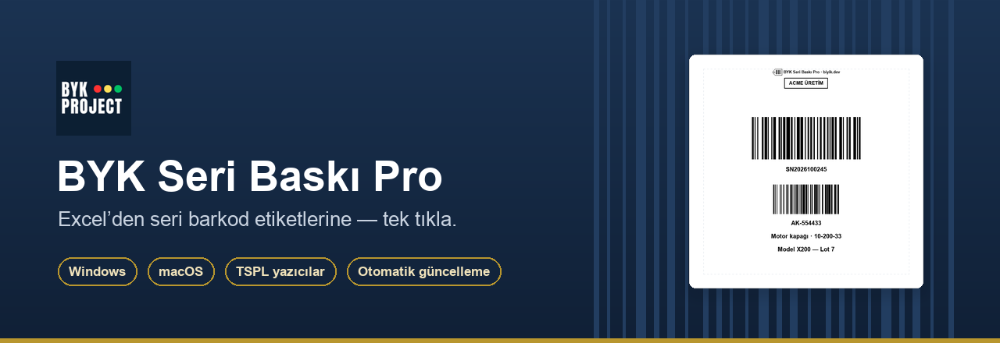
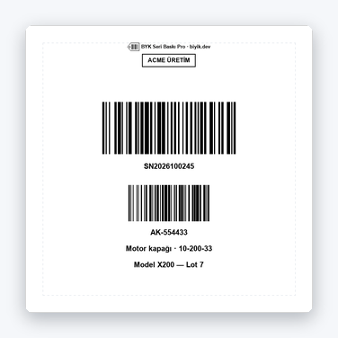
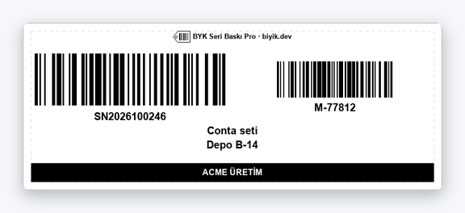
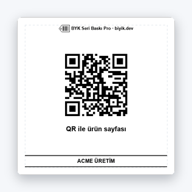
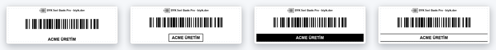
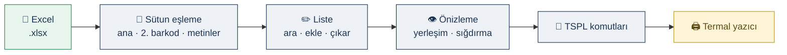

<p align="center">
  
</p>

<p align="center">
  <a href="https://github.com/metinfarukbiyik/bykseripro/releases/latest"></a>
  
  
  
  
</p>

<p align="center">
  <a href="https://github.com/metinfarukbiyik/bykseripro/releases/latest/download/BYKSeriBaskiPro_Kurulum.zip"></a>
  &nbsp;
  <a href="https://github.com/metinfarukbiyik/bykseripro/releases/latest/download/BYKSeriBaskiPro_macOS.zip"></a>
  &nbsp;
  <a href="https://biyik.dev/byk-seri-baski-pro"></a>
</p>

<p align="center">
  <a href="#-neden-byk-seri-baskı-pro">Neden?</a> ·
  <a href="#-etiket-örnekleri">Örnekler</a> ·
  <a href="#-özellikler">Özellikler</a> ·
  <a href="#-nasıl-çalışır">Nasıl çalışır?</a> ·
  <a href="#-uyumlu-yazıcılar">Yazıcılar</a> ·
  <a href="#-kurulum">Kurulum</a> ·
  <a href="README_KULLANICI.md">Kullanım rehberi</a>
</p>

---

## 💡 Neden BYK Seri Baskı Pro?

Üretimde, depoda ya da satışta yüzlerce **seri numarası ve barkod etiketini** tek tek hazırlamak hem zaman alır hem hataya açıktır. BYK Seri Baskı Pro, Excel listenizi doğrudan termal etiket yazıcısına bağlar.

<table>
  <tr>
    <td width="33%" valign="top">
      <h3>📄 Excel’i açın</h3>
      Her satır bir etiket olur. Sütun adları serbest — <i>Barkod, Seri No, M Barkod, Model…</i> program tanır.
    </td>
    <td width="33%" valign="top">
      <h3>👁️ Önizleyin</h3>
      Ekrandaki görüntü kağıttakiyle <b>birebir</b> aynıdır. Sığmayan etiket kırmızı çerçeveyle uyarılır.
    </td>
    <td width="33%" valign="top">
      <h3>🖨️ Basın</h3>
      Seçili satırları ya da tüm listeyi tek tıkla basın. Yanlış satırı listeden çıkarın, eksik seriyi elle ekleyin.
    </td>
  </tr>
</table>

---

## 🏷️ Etiket örnekleri

Aşağıdaki görseller programın kendi önizleme motoruyla üretildi — yazıcıdan çıkan etiketle aynıdır.

<table>
  <tr>
    <td align="center" valign="bottom"></td>
    <td align="center" valign="bottom"></td>
    <td align="center" valign="bottom"></td>
  </tr>
  <tr>
    <td align="center"><b>98 × 98 mm</b><br><sub>İki barkod alt alta · çerçeveli marka</sub></td>
    <td align="center"><b>100 × 40 mm</b><br><sub>Dar etiket · barkodlar yan yana · siyah bant marka</sub></td>
    <td align="center"><b>60 × 60 mm</b><br><sub>QR kod · çizgili marka</sub></td>
  </tr>
</table>

---

## ✨ Özellikler

| | Özellik | Açıklama |
|:--:|---|---|
| 📄 | **Excel’den toplu etiket** | Ana barkod, 2. barkod, orta ve alt metin. Başlık adları serbest; roller otomatik eşlenir |
| 👁️ | **Birebir önizleme** | Yazıcıya giden konumlarla aynı çizim; kenar boşluğu kılavuzu ve taşma uyarısı |
| 📐 | **Her etiket boyutu** | 2. barkodu yan yana alın, **otomatik sığdırma** boşluk / barkod / fontu küçültsün |
| 🔤 | **Türkçe ve tam ortalı metin** | Uzun yazılar satırlara bölünür, her satır ortalanır; ı ş ğ İ doğru basılır |
| 🎨 | **Tasarımlı markalama** | Firma adınızı açıp kapatın; konum, boyut ve 4 stil |
| ✏️ | **Listeyi elle düzenleme** | Excel’i açmadan seri ekleyin, yanlış satırı çıkarın, <kbd>Ctrl</kbd>/<kbd>⌘</kbd>+<kbd>Z</kbd> ile geri alın |
| 🔢 | **Seri üretim** | Önek + sayı + sonek ile Excel’siz seri listesi |
| ▦ | **Barkod tipleri** | Code 128 · Code 39 · Code 93 · EAN-13 · EAN-8 · QR Kod |
| 🖨️ | **Yazıcı uyumluluk denetimi** | Seçilen yazıcının TSPL desteğini gösterir; 203 / 300 / 600 DPI |
| 🎯 | **Kalibrasyon** | Baskı kaymasını mm hassasiyetinde düzeltin |
| 🔄 | **Otomatik güncelleme** | Yeni sürüm çıkınca bildirim; tek tıkla kurulum, ayarlar korunur |

### 🎨 Marka stilleri

<p align="center">
  
</p>
<p align="center"><sub><b>Düz</b> · <b>Çerçeveli</b> · <b>Ters (siyah bant)</b> · <b>Üst-alt çizgili</b> — her etiketin üstünde küçük program imzası yer alır</sub></p>

---

## ⚙️ Nasıl çalışır?



### 📊 Excel formatı

İlk satır **başlık**, sonraki her satır **bir etiket**tir.

| Rol | Örnek başlıklar | Zorunlu |
|---|---|:--:|
| **Ana barkod / seri no** | `Barkod` · `Seri No` · `Barcode` | ✅ |
| **2. barkod** | `A-K Barkod` · `M Barkod` · `C Barkod` · `2. Barkod` | — |
| **Orta metin** | `ItemNo` · `Açıklama` | — |
| **Alt metin** | `ParcaAd` · `Model` | — |

> 💡 Adında **barkod / barcode / qr** geçen ikinci sütun otomatik olarak 2. barkod kabul edilir. Tanınmayan sütunlar soldan sağa sırayla kullanılır; bir sütun iki role verilmez.

---

## 🖨️ Uyumlu yazıcılar

Program etiketleri **TSPL / TSPL2** komut diliyle gönderir. Seçtiğiniz yazıcının uyumu yazıcı listesinin hemen altında gösterilir.

| | Markalar |
|:--:|---|
| ✅ **Çalışır** | Xprinter · TSC · Gprinter · HPRT · iDPRT · Rongta · Munbyn · Zenpert · Beeprt · Polono ve diğer TSPL uyumlu modeller |
| ❌ **Çalışmaz** | Zebra (ZPL) · Godex (EZPL) · Brother · DYMO · lazer / mürekkep püskürtmeli ofis yazıcıları |

> 🔎 Yazıcınızın etiketinde **203 DPI** veya **300 DPI** yazar — programda aynı değeri seçin.

---

## 📦 Kurulum

<table>
  <tr>
    <th width="50%">🪟 Windows 10 / 11</th>
    <th width="50%">🍎 macOS 12+</th>
  </tr>
  <tr>
    <td valign="top">

1. [**Windows paketini indirin**](https://github.com/metinfarukbiyik/bykseripro/releases/latest/download/BYKSeriBaskiPro_Kurulum.zip)
2. Zip’i açın → `BYKSeriBaskiPro_Kurulum.exe`
3. Klasörü seçin → **Kurulumu Başlat**

<sub>SmartScreen uyarısında: <i>Ek bilgi → Yine de çalıştır</i></sub>

</td>
    <td valign="top">

1. [**macOS paketini indirin**](https://github.com/metinfarukbiyik/bykseripro/releases/latest/download/BYKSeriBaskiPro_macOS.zip)
2. Zip’i açın → `BYKSeriBaskiPro.app`’i **Uygulamalar**’a taşıyın
3. İlk açılışta: **sağ tık → Aç → Aç**

<sub>Yazıcıyı <i>Sistem Ayarları → Yazıcılar ve Tarayıcılar</i>’dan ekleyin</sub>

</td>
  </tr>
</table>

### 🔄 Güncellemeler

Program her açılışta yeni sürümü kontrol eder. Yeni sürüm varsa **“Güncelleme geldi”** penceresi bu sürümdeki yenilikleri listeler; **Şimdi güncelle** ile program kapanır, yeni sürüm kurulur ve yeniden açılır. Ayarlarınız ve Excel dosyalarınız korunur.

Ayrıntılı kullanım, ipuçları ve sık sorulan sorular için 👉 **[Kullanım rehberi](README_KULLANICI.md)**

---

<details>
<summary><b>🛠️ Geliştirici notları</b></summary>

<br>

**Kaynaktan çalıştırma**

```bash
pip install -r requirements.txt
python app.py            # veya scripts\windows\BASLAT.bat · scripts/macos/BASLAT.command
```

**Sürüm yayınlama — tam otomatik**

`main`’e yapılan her push (yalnız doküman değişiklikleri hariç) [Release packages](.github/workflows/release.yml) iş akışını çalıştırır:

1. Sürüm numarası otomatik artar (`v1.2.3 → v1.2.4`); büyük sürüm için yalnız `VERSION` dosyasını değiştirin
2. Windows + macOS paketleri derlenir
3. Release yayınlanır; **commit mesajları “Yenilikler” listesi olur** ve kurulu programların güncelleme penceresinde görünür (`docs:` / `ci:` / `chore:` ile başlayanlar atlanır)

**Yerel paketleme**

| Platform | Komut | Çıktı |
|---|---|---|
| Windows | `scripts\windows\BUILD_RELEASE.bat` | `release\BYKSeriBaskiPro_v…_Kurulum.zip` |
| macOS | `scripts/macos/BUILD_RELEASE_MAC.sh` | `release/BYKSeriBaskiPro_v…_macOS.zip` |

**Proje yapısı**

```text
├── app.py                 Giriş noktası (src/'yi yükler)
├── src/                   Uygulama kaynak kodu
│   ├── main_window.py         Ana pencere
│   ├── tspl_builder.py        Etiket yerleşimi + TSPL üretimi
│   ├── label_preview.py       Birebir önizleme   · text_render.py  grafik metin, imza ikonu
│   ├── excel_loader.py        Excel okuma ve sütun eşleme
│   ├── layout_dialog.py       Yerleşim ayarları  · label_entry_dialog.py  elle seri ekleme
│   ├── printer_raw.py         RAW baskı           · printer_compat.py  yazıcı uyumluluğu
│   ├── updater.py             Güncelleme          · update_dialog.py · setup_wizard.py
│   └── branding.py            Ad, ürün sayfası — tek kaynak
├── resources/             Varsayılan config.json + örnek Barkod.xlsx
├── assets/                İkonlar, README görselleri
├── packaging/             PyInstaller .spec dosyaları
├── scripts/
│   ├── windows/           BASLAT · BUILD_EXE · BUILD_RELEASE · KURULUM · KALDIR (.bat)
│   └── macos/             Aynıları (.command / .sh)
├── tools/                 İkon ve README görseli üretimi
├── docs/                  Dağıtım notları (zip içine OKU_BENI.txt olarak girer)
└── .github/workflows/     Otomatik sürüm yayınlama
```

**Görseller ve ikonlar**

```bash
python tools/readme_images.py    # assets/readme/*.png (README görselleri)
python tools/prepare_icons.py    # assets/app.ico vb.
```

Ayarlar `config.json` dosyasında tutulur — kurulu programda Windows: kurulum klasörü, macOS: `~/Library/Application Support/BiyikDev/BYKSeriBaskiPro`; kaynaktan çalışırken git dışı `local/` klasörü.

</details>

---

<p align="center">
  <a href="https://biyik.dev/byk-seri-baski-pro">🌐 biyik.dev/byk-seri-baski-pro</a> &nbsp;·&nbsp;
  <a href="mailto:metin@biyik.dev">✉️ metin@biyik.dev</a> &nbsp;·&nbsp;
  <a href="https://wa.me/905404613543">💬 WhatsApp</a>
</p>

<p align="center">
  <sub>© BIYIK.DEV — Metin Faruk BIYIK · Tüm hakları saklıdır · <a href="LICENSE">Lisans</a></sub>
</p>
